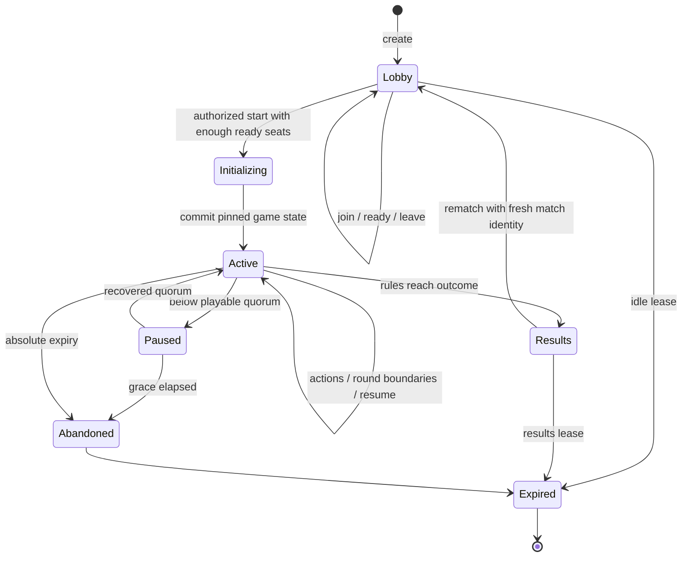

# Room lifecycle and common UX

Landing gives group size, time, one round example, data needs and Create/Join. In lobby show join link, code, QR plus text alternative, ready count, missing players, accessibility options, host and leave control. A first-time player tries one example before ready. Start requires the configured min/max and all enrolled players ready. Wedding uses the event opening rule in its GDD. Freeze eligible seats at start. Late arrivals can wait for rematch, except Wedding's controlled round-boundary admissions. Recheck roster in the start transaction. Allocate a new match ID, roles and content version atomically. Existing sockets switch to the new match only on server snapshot.

During play the default screen prioritizes your next action, who/what is pending, server deadline and confirmation of receipt. Offer an untimed lobby tutorial, visible full instructions and a lobby-wide extended-timer setting (double ordinary phase deadlines, subject to maximum lease). Timeouts resolve via each GDD's default. For ordinary small-room games use game-declared connected quorum (default starting minimum until evidence warrants change). Below quorum after heartbeat grace, pause once per match up to 90 s and persist remaining phase time, pause deadline and generation. Resume on recovery. After grace abandon without winners, except for the documented Wedding policy. On a subsequent quorum loss abandon immediately. Real network disconnects get a short heartbeat grace (two missed 15 s heartbeats) before quorum decisions. An explicit leave is immediate. A timeout with enough connected seats uses the game fallback. Restore remaining time on resumption. All-offline rooms follow the same clock without client intervention.

A host is a coordinator. After 30 s without a host, elect the oldest connected eligible member by stable join sequence. A returning host keeps their seat. Co-host grant and presentation permissions for Wedding have separate rules. Host migration does not re-deal, unlock hidden data or transfer external purchases. Refresh resyncs from persisted match/phase/deadline/view. Intact-volume restart sets presence unknown, fences old connections, checks absolute lease first and allows recovery for up to 90 s, never past lease. Do not default multiple meaningful phases while nobody is online. Resolve at most one elapsed phase after quorum recovery; otherwise abandon at grace expiry. Timers use phase/deadline generation. Lost/rolled-back volume never revives transient matches.

Results include reason, authorized reveal, scoring breakdown, opt-in share preview and rematch. Leave and rematch are separate. Rematch invites returning seats to a fresh ready check, clears votes, privileges specific to a match, private hands and scores, and rotates/shuffles as specified. Cleanup revokes access, deletes expired room data and cancels timers/unused grants. Public routes continue to work on expiry. [Deployment](../planning/DEPLOYMENT.md) defines restart/restore requirements.

**Shared accessibility and failure states.** Keyboard and touch parity, 44 CSS px target where feasible, visible focus, text labels plus icons, readable contrast, reduced motion, no forced audio, labeled numeric countdown and a few announced time warnings. Render a skeleton only during first fetch. Show “waiting for other players” after submit, actionable reconnect/permission/full/expired messages and a link back to public instructions. Offline disables commitments and shows last acknowledged state. Results and errors receive purposeful focus. Public sharing omits room codes, names, evidence, private text and media by default.

## Identity and game exceptions (IR-C01, IR-C02, IR-H02)

All state-changing lifecycle operations use queue, auth, revision and transaction. Kicked seat revoked for match; election excludes revoked/disconnected/display principals. Returning former host ordinary seat unless re-granted; host transfer never transfers paid entitlement. Wedding admission/roster and pre-granted operator differ; Voice withdrawal revokes media immediately; Cold Case clue release trusted system/timer action. Absolute leases apply while paused; no grace renewal via refresh.
