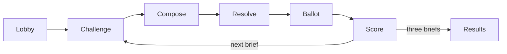

# AI Battle Arena

**2–8 players · 10–18 minutes · creative groups or classrooms with a facilitator.** Compete to steer a fixed model toward a brief using a limited prompt budget. A published replay pack contains real, previously generated responses to all legal instruction combinations, with model/date and an editorial rubric. Generation takes place during authoring. The MVP has no per-match model calls. Tell players exactly how the replay works.

## Rules for a meaningful zero-API match

Publish at least six original bilingual challenge briefs. Select three without replacement using a seed. Per brief offer three intent options, two formats and two constraints, yielding exactly 12 legal prompt recipes. Each seat chooses one option from each group in 45 s. Each option has a displayed cost of 1 or 2 craft points. Budget is 5 per round, no carryover. Authoring must ensure every option occurs in at least one affordable combination and at least two affordable recipes achieve the highest objective score. All players get the same starting budget, complete rubric and version. Store the full 12-cell response matrix for each locale, plus source/provenance and rights, with outputs hidden until commitment. A timeout is a pass, worth zero. Identical choices yield identical output and score.

Resolve each output against three public deterministic binary predicates identified in the brief. Award 1 point per predicate. Define text normalization for the locale (NFC Unicode, consistent whitespace/line breaks, token-aware case folding when appropriate). Never judge fluency by a universal English word count. One practice brief asks for a two-line ferry notice. Award one point for exactly two nonempty lines, one for containing the specified departure time “18:15”, and one for naming the specified pier. Choosing instructions to include time and location may sacrifice tone. A reviewed response with two lines containing both values earns 3. The results screen highlights each satisfied criterion.

For three or more active submitting seats, open a 20 s anonymous “best voice” ballot on distinct outputs. Each author may vote for a group they did not submit. Abstention is allowed. Identical outputs form one group. If there is only one group, fewer than three submitters, a tie for first or no votes, award no bonus. Otherwise each author of the winning group earns 1 creativity point. Two-player matches always use objective points alone. Publish aggregates, then running totals. After three briefs highest combined score wins, then higher total objective score, then shared victory. All players passing yields an unranked incomplete match. Rematch favors unseen briefs and resets scores/budgets. A disconnected seat that already submitted retains its result.

## Content, fairness and paid extension

The author must obtain real outputs once for each cell, store immutable hashes and review both language variants. If affordable original/licensed outputs cannot be sourced, hold launch. No fake generation typing indicator. Curated matrices can be memorized. Rotate briefs, show pack version, measure replay with unseen packs. Exclude high-risk domains, personal data, tool execution, secret extraction and executable user code. Raw free-text prompting, image generation and externally pasted outputs are future modes with separate fairness tests. A funded provider interface would generate a bounded response for a versioned brief, return usage, provider/model version and safe status. Never let output invoke tools, mutate scores or see private state. BYOK creates a support, secret-storage and fairness burden. Keep it out of the pilot. [Cost controls](../planning/DEPLOYMENT.md) · [Security](../planning/SECURITY.md)

Landing shows one solved practice brief with rubric. Lobby labels the pre-generated mode. The UI resembles a typesetter's proof in navy (#192638) on pale mint (#E7F8E9), with mono for diffs and sans body. Preview selected options and remaining budget. Reveal outputs together without authors, mark passed turns and display objective checks even if voting is skipped. Offer a neutral, original challenge card to share. Test two-player tie, duplicate authors, ineligible self-vote, partial/time-out, all-pass, over-budget rejection, parity of both language rubrics, output escaping and exactly zero inference requests for a real end-to-end match. If later live generation fails, refund reserved credits and allow a fresh replay-mode round for the whole room.

## Lifecycle and integration

The [room lifecycle](../contracts/room-lifecycle.md) specifies create, join, ready, initialization, resumption, host loss, minimum quorum, results, fresh rematch and cleanup, including loading, offline, empty and expired screens. Apply the game-specific exceptions above. Implement this module under `src/games/ai-battle-arena/`. Its intents, projections and regression fixtures must satisfy the [module](../contracts/game-module-contract.md) and [wire contracts](../contracts/multiplayer-events.md). Publish reviewed EN/VI rules and controls for phone and desktop browsers.
