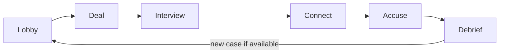

# Cold Case Vietnam

**3–8 players · 25–40 minutes · mystery fans, mixed-language friends and reading groups.** Reconstruct one fictional event from private fragments. A correct conclusion needs corroboration, so one fast reader cannot finish the case alone. Needs a private case loader, clue release, shared evidence board, secret ballots and a server-side answer key.

## Case format and original tutorial

A versioned case contains public metadata, locale-neutral IDs, trigger stage, accessible text/transcript for every item, localized labels/body, clue source, candidate answers, supporting evidence pairs, neutral hints and a debrief. Stable answer IDs align across languages. Authoring checks validate referenced IDs, deadlines, unlock graph acyclicity and completeness, independent corroboration per answer, alternative theories and equal information in both translations. Ship one complete original case and an unrelated tutorial. Gate new packs on blind solves. The public tutorial below is deliberately spoilable. License and distribute premium solutions privately.

**The Indigo Lantern** takes place at an invented riverside theatre. A lantern vanishes before rehearsal. Possible handlers are Kha (stagehand), An (curator) and Binh (driver). Possible destinations are loft, truck and dye room. Possible reasons are a leaking roof, an inventory count and a rehearsal cue. Eight artifacts establish the solution.

| ID | Independently readable fragment |
|---|---|
| E1 | Loft transfer slip names An as the carrier and lists item L7. |
| E2 | A prop cleaner saw the curator lift L7 from the soaking display. |
| E3 | The loft inventory log records L7 arriving at 18:15. |
| E4 | A later sketch shows L7 beside the loft's fixed skylight. Provide an equivalent text description. |
| E5 | A roof inspection at 18:05 reports drips directly above L7. |
| E6 | A signed note says the move was to keep L7 dry before the repair. |
| E7 | The driver left at 17:52 with stools only. |
| E8 | The stagehand's rehearsal cue references lantern L2. |

An moved L7 to the loft because of the leaking roof. Pair E1/E2 supports handler, E3/E4 place, E5/E6 motive. The group should discuss whether the transfer slip alone excludes someone carrying it later. Give a timeline explanation on reveal.

A minimal authoring example uses the same structure for every finding. Store reader-facing strings in separate EN/VI dictionaries. Only the public descriptor and explicitly public tutorial may enter the static build.

```json
{
  "schemaVersion": 1,
  "caseId": "indigo-lantern-tutorial",
  "version": "1.0",
  "fields": [
    {"id":"handler","options":["kha","an","binh"],"answer":"an","supportPairs":[["E1","E2"]]},
    {"id":"place","options":["loft","truck","dye-room"],"answer":"loft","supportPairs":[["E3","E4"]]},
    {"id":"reason","options":["leak","count","cue"],"answer":"leak","supportPairs":[["E5","E6"]]}
  ],
  "deal": {"method":"shuffled-round-robin","clueIds":["E1","E2","E3","E4","E5","E6","E7","E8"]},
  "hints": ["compare-carriers","check-weather"],
  "debriefKey": "indigo.debrief"
}
```

Each clue record also needs id, medium, localized body/alternative keys, accessibility equivalent and stage availability. Pack validation compares locale coverage and source independence for solution pairs. For this sample, the first hint asks which witness independently saw the carrier. The second asks which evidence mentions water before the move.

## Rules and decision procedure

Shuffle seats and eight clue IDs with the case seed and distribute round-robin. Every seat gets at least one. Seats are equal investigators. Begin with 5 minutes of interview, then 8 minutes of linking, then 3 minutes for conclusion. Permit moving on early by a strict majority of all seated players. A different full case may configure longer stages with disclosed limits. During interview only holders can read or publish their clues. During linking players may publish clues and propose a candidate triple with two different published clue IDs per field. Suggestions appear labeled by seat. Each group may use two hints from a fixed sequence. Hints cost one point each. A disconnected holder's clue becomes available to the team in linking after 60 s of absence, and all remaining clues auto-publish on entering the conclusion stage. This rule is explicit in the tutorial. Never auto-publish solutions.

Each seat casts one private ballot for a complete proposed submission. If nobody proposed, any seat can still construct a submission during conclusion. Count ballots at expiry or when all are locked. Highest count wins. Ties use earliest server-accepted proposal among tied proposals, disclosed before voting. No ballots or no submitted proposal ends unsolved. Score each correct field 1 plus 1 for its authored supporting pair in either order when the field is correct. Score = max(0, sum − hints). A solved case requires all three fields and at least two correct pairs on the selected proposal. The team shares success or defeat independent of speed. Reveal all reasoning and which alternatives fail. No ranking of readers. Rematch recommends an unseen case and warns of spoilers for a repeated case.

**Example.** Five seats share E1 and E2, compare the time of the truck's departure, and submit An/loft/roof with pairs 1+2, 3+4, 5+6. With one hint they score 5/6 and solve it. Correct guesses with no supporting pairs cannot win.

## Experience and validation

Use rice-paper (#FBF4E2) and deep blue (#193D52), a legible serif case title, sans testimony and a vertical timeline. Provide large text, alt text, sortable timestamps and a linear list equivalent to any spatial board. No timed audio clues. Private evidence gets a deliberate “share with group” confirmation. Landing shows one unrelated sample, content note and spoiler boundary. Results sharing contains title, completion and optional score. Future Vietnamese districts and international packs require local editors and analogous clues. Extra languages must preserve contradictions.

Guard against brute-force resubmission with one resolved verdict and no mid-match correctness feedback. Prevent one voice taking over by distributing clues and offering independent ballots. Accept when the same engine loads two structurally different test cases without code changes, 3/8-seat deals cover every clue once, a vanished seat cannot deadlock the case, every authored answer has sufficient evidence, no answer-key strings ship in client assets and both locale teams can solve from the provided artifacts.

## Lifecycle and integration



The [room lifecycle](../contracts/room-lifecycle.md) specifies create, join, ready, initialization, resumption, host loss, minimum quorum, results, fresh rematch and cleanup, including loading, offline, empty and expired screens. Apply the game-specific exceptions above. Implement this module under `src/games/cold-case-vietnam/`. Its intents, projections and regression fixtures must satisfy the [module](../contracts/game-module-contract.md) and [wire contracts](../contracts/multiplayer-events.md). Publish reviewed EN/VI rules and controls for phone and desktop browsers.
