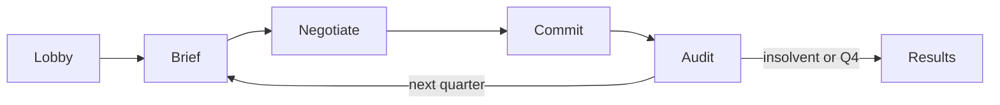

# Corporate Chaos

**4–10 players · 18–30 minutes · office groups and strategy-minded friends.** Keep a fictitious company solvent while quietly directing work toward your own review targets. A public project audit reveals where effort went without exposing who made each commitment. No elimination. Requires private objectives, a seeded event deck, simultaneous orders and a public audit trail.

## Rules

Four quarters. Each seat starts with zero prestige and one private credit representing documented project work (maximum two credits). Shared runway starts at 2, capped at 4. Shuffle seats. Deal public roles from a rotating deck of Lead, Engineer, QA and Steward (repeat for larger groups). Deal each seat one private mandate uniformly from Delivery, Trust or Visibility. Role power is once per game. Draw four event cards without replacement from a six-card deck containing two normal quarters, delivery crunch (+1 delivery target), audit (+1 trust target), small contract (success earns one extra runway), and hiring freeze (failure costs one extra runway). Process events before commitments. All card counts and mandate categories are public.

Each quarter separate a 60 s negotiation from a 30 s sealed order. Each player allocates exactly two indivisible effort among Delivery (D), Trust (T) and Visibility (V). At audit, each effective V can spend a previously banked work credit for one prestige, even in a failed project. Redeem as many as possible. In a successful quarter gain one prestige if an own base effort reached the featured department (D in Q1/Q3, T in Q2/Q4). Then gain one work credit, up to the cap, if both own effective base units were allocated to D/T and the project succeeded. Role bonus units and automatic orders never mint credits or earn the featured award. Base targets are D >= ceil(N/2) and T >= floor(N/2). Use starting seat count N throughout. An unsubmitted order defaults to one D and one T, earns no prestige or mandate credit that quarter. A submitted order may activate one role power. Lead adds one D, Engineer converts one of their V into two D (removing its opportunity to redeem a credit), QA adds one T, Steward restores one runway after a successful quarter. Reject an impossible use before committing. Extra role units count for project totals only, not mandate credit. Use only one order per seat, revisable with the seat's current submission version before close.

Reveal aggregate D/T/V and whether each role class was used. Do not publish individual orders. If both targets are met, add one runway plus any event/Steward award, cap 4. Otherwise subtract one plus applicable event penalty, floor 0. Track each submitting seat's effective own D/T/V contributions (after conversion, excluding bonus units). At zero runway immediately everybody loses. Otherwise after Q4 add 3 personal prestige for contributing at least four units to the category on your mandate over the game. Rank by total prestige, then highest number of quarters with at least one own D or T in successful projects. Any remaining tie is shared. The company survives separately from the individual ranking. No saboteur with an incentive to ruin a workplace training session.

**Example.** At N=5 a normal brief needs 3D and 2T. Orders total 2D, 3T and 5V before abilities. Lead spends their once-per-game bonus to make 3D. Runway rises from 2 to 3. A seat with two V and one banked credit redeems one prestige. A colleague with one D and one T earns the Q1 featured point and replenishes a credit. Two quarters later players who inferred an emphasis on Visibility can bargain for more Trust, but cannot inspect the Lead's mandate. A final 4V contribution tally earns the Visibility bonus only once.

## Interface, failure and validation

Use an ivory ledger (#FFF9E9), navy ink (#192E42), a serif briefing headline and tabular system numerals. Slide project slips into two labeled tracks with reduced-motion substitution. Optional single chime on audit. Landing has a one-quarter worksheet and count/duration. Tutorial practices one 2-point allocation. Lobby previews public powers. Show remaining effort, targets, private mandate and a review/commit control. Results reveal mandates and an aggregate contribution timeline. For corporate pilots share a team debrief about trade-offs, without naming a “worst employee”. Later consider new departments and facilitated packs.

Early rule review exposed a free ride: unconditional Visibility points let one employee take credit for everyone else’s work. The credit requirement and alternating featured department give a successful contributor a competing personal reward. A threshold failure threatens every seat. Simulate free-riders against cooperative and conditional bots by seat count, especially four players, and pilot a smaller Visibility payout if concentrated wins persist. Test that a player who never works can redeem at most the one starting credit. Check conservation of exactly two base efforts, legal conversion, event cap/floor, no second role use after reconnect, all-fail elimination at zero, four-quarter termination and absence of others' mandates in lobby/play/host views. Shift optional deadlines for accessibility. The common quorum policy handles attrition. While enough seats remain the default order sustains the board.

## Lifecycle and integration

The [room lifecycle](../contracts/room-lifecycle.md) specifies create, join, ready, initialization, resumption, host loss, minimum quorum, results, fresh rematch and cleanup, including loading, offline, empty and expired screens. Apply the game-specific exceptions above. Implement this module under `src/games/corporate-chaos/`. Its intents, projections and regression fixtures must satisfy the [module](../contracts/game-module-contract.md) and [wire contracts](../contracts/multiplayer-events.md). Publish reviewed EN/VI rules and controls for phone and desktop browsers.
