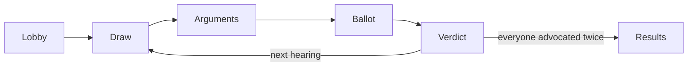

# Friend Court

**4–12 players · 8–25 minutes · co-located or on an existing group call.** Improvise a remedy for a fictional petty dispute, then hear how the other side used the very same piece of evidence. The appeal to casual hosts is a first turn that needs one sentence. Needs the core server, private submission and ballot, a timer and bilingual original prompts. This is the provisional first vertical slice, subject to P0 candidate comparison.

## Playable first edition

Ship 16 edited dockets per language. Each contains an imaginary defendant, a silly act, a neutral clue and two distinct remedies. In one docket, a clockwork pigeon delivered a birthday invitation one day early. The clue is a calendar with two Fridays. One advocate asks for a rehearsal party, the other for a public clock inspection. Players argue for remedies. No real person is put on trial. Before ready, try the practice prompt and choose speaking, typing or passing. The in-person/call voice is outside the app and is never recorded.

1. Shuffle the seat order and sample N distinct dockets with a server seed. Run N hearings. On hearing i, seat i advocates remedy A, the next seat cyclically advocates B, all other seats form the jury. The first juror after B reads the docket as clerk and still votes. Alternate which side presents first across hearings. Each seat advocates exactly twice.
2. Display the shared clue and remedies. Give each advocate 25 seconds to speak, post one plain-text argument of up to 180 characters, or pass. A submitted text is visible to the room. A moderator or affected player may flag it for immediate concealment. Either advocate may privately request replacement during a 10 s pre-argument window, at most once total per hearing. Close early if both accept the docket; otherwise close on deadline. Once closed, replacement is disabled. Replacement draws a fresh unused prompt or unused neutral reserve. If none remains, deny the request with a neutral explanation. Arguments start only after the window closes; no accepted argument is discarded. Multiple replacement requests collapse to one.
3. Jurors privately choose A, B or abstain within 15 seconds. One final vote per juror. Show only committed count until close. Give one point to the winning advocate, zero to the other. A tied nonempty ballot gives one point to each participating advocate. With one pass, the sole participant receives one point only if a majority of non-abstaining ballots chose that remedy. Two passes or zero votes yield zero. When both advocates pass, close the hearing immediately.
4. After all hearings show totals and up to one group-selected favorite fictional remedy. Highest points wins, equal leaders share. Never break ties by speed, applause or raw audience size. Rematch rotates the first seat and prefers unused dockets until exhausted. Custom accusations, a public feed and premium packs are later editorial work.

**Example.** Four seats A–D. A argues for a rehearsal and B for an inspection. C votes A, D abstains. A earns 1. Hearing two pairs B/C, then C/D, then D/A. A 2–2 final tie yields joint winners. A reconnecting juror cannot get a second ballot. An advocate who misses their turn passes.

## Interaction, balance and release tests

The landing page uses an illustrated fictional docket, two short sample arguments and a private-room invitation. Lobby shows text/pass controls. Play uses a cream (#FFF7E6) docket and ink (#352742), a high-contrast verdict stamp, system serif titles and sans body. Stamp motion is optional, with a silent text equivalent. Display the accepted argument before advancing focus to the jurors. Share an original prewritten verdict line only, with preview.

Friendship blocs and confident speakers can dominate. Keep voting private, rotate both jobs evenly, offer typed or passed turns with no public explanation, and allow the neutral-docket replacement. Evaluate original VI humor separately from EN. Ship only after a 4-seat and 12-seat fixture each completes N hearings, a 1–1 ballot scores both, a zero-vote hearing scores nobody, a pass cannot win the passers' point, reveal hides ballots, and rematch restores every seat to zero. In a moderated playtest check whether quiet players choose a second turn.

## Lifecycle and integration

The [room lifecycle](../contracts/room-lifecycle.md) specifies create, join, ready, initialization, resumption, host loss, minimum quorum, results, fresh rematch and cleanup, including loading, offline, empty and expired screens. Apply the game-specific exceptions above. Implement this module under `src/games/friend-court/`. Its intents, projections and regression fixtures must satisfy the [module](../contracts/game-module-contract.md) and [wire contracts](../contracts/multiplayer-events.md). Publish reviewed EN/VI rules and controls for phone and desktop browsers.

## Independent review gate (IR-H07, IR-M03)

Direct browser debate competitors include Rebut! and Argumento; differentiation is a hypothesis around fictional remedies, paired evidence, bilingual no-TV play and quiet-player inclusion. Initial private pilot 4–6 players; 12-seat boundary remains a test, not public capacity. At 12 each player advocates twice and juries ten other hearings; measure idle and pass time. At four, one juror plus abstention can decide a win and reciprocal coalitions can inflate ties. Compare current nonempty-tie scoring to zero-point ties and alternative majority rules in paper play; retain original only if no repeatable collusive advantage. Ship 16 edited dockets plus distinct neutral reserve or disclose bounded replacement availability; never silently repeat a docket within a match. Test replacement race, exhaustion, passes, ties, deadlines and flag concealment. Compare P0 preference and unaided completion with Corporate before S1 approval; rule/scoring changes beyond those above need playtest evidence.
