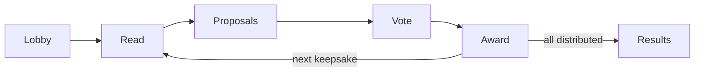

# Inheritance War

**5–10 players · 20–30 minutes · groups who enjoy negotiation.** Play fictional trustees deciding who should steward family keepsakes. Build coalitions over *where* an item goes as well as *who* gets credit. The aim is a short social strategy game with a visible allocation history and hidden stewardship pledges. Needs private mandates, limited voting influence and atomic awards.

## Rules

There are N distinct lots for N seats. Each lot has one tag (craft, memory or garden). Cycle tags in that order then shuffle lots. Link each seat to the next clockwise as its public ally. Give each seat three influence, zero prestige and a private pledge for one tag drawn uniformly from the tags present. New seed per match. Each seat chairs exactly one lot in seat order. The chair has 40 s to name one seat as personal custodian (may name self). The next clockwise seat is challenger and has 25 s to name a different custodian or choose the common archive. If the chair times out its proposal is archive. Challenger timeout defaults to archive unless that duplicates the chair, then nominate the challenger. Server validates nomination and fallback eligibility. Each seat may personally hold at most two lots. If challenger fallback is ineligible choose the first eligible seat clockwise, skipping the chair nominee. Archive always has capacity.

Discuss for 40 s with both options visible. Every seat, including nominees, secretly votes A, B or abstain. A ballot has weight 1. A seat may spend exactly one remaining influence to make it weight 2. Lock within 20 s. Deduct spent influence even on a losing vote. No votes defaults to archive. On a positive weighted tie the archive holds the lot even when absent from the ballot. Otherwise winning custodian receives the lot and 2 prestige or the archive permanently keeps it. Publish aggregate totals and custody history, never named ballots or remaining influence. Ineligible or duplicate nomination is rejected before phase advance. If no eligible personal nominee remains, award archive directly.

After N lots, gain 2 pledge points per matching lot in the archive (cap 4 per player), and 1 relationship point if your public ally holds exactly one lot. Highest prestige plus bonuses wins, then more unspent influence, then share. No elimination or transfers after awards. Archive ties can be deliberate plays. Private promises have no mechanical force. Each person may once call a “reading” during discussion to display how many of each tag remain (the same info can be derived from published setup), then add 10 s once per lot. This is accessible to everyone without buying an ability.

**Example.** Six trustees vote on a craft loom. The two nominees earn weighted totals 4 and 4. The loom enters the archive. Any craft pledger can gain 2 at final scoring. A player spending their final influence on that tie cannot double the next ballot. After six lots the ledger accounts for every item.

## Experience, balance and tests

Use burgundy (#592135), parchment (#FFF5DF), bookish serif headings and labeled wax-seal icons. Animate opening a will once, with optional soft page sound. The lobby establishes fictional relationships without requests about real family. Tutorial demonstrates a tied ballot. During play show current lot, two proposals, private pledge and influence remaining. Present archive and individual score components separately. Pass on personal discussion without penalty. Share the fictional estate's archive list. Future packs change lots and pledge sets only after validating economic balance.

Risks include permanent voting pairs and kingmaking. Cap custody, rotate chairs, limit weighted ballots and test at odd/even sizes. If an AFK chair never proposes, the lot still advances using defaults. Assert N rounds, N accounted-for lots, influence 0–3, personal holdings <=2, archive tie determinism, and no secret pledge exposure before results. Simulate always-self versus archive strategies. Test the case where a capped favorite is proposed. Never expose an ineligible target merely as clickable in the UI.

## Lifecycle and integration

The [room lifecycle](../contracts/room-lifecycle.md) specifies create, join, ready, initialization, resumption, host loss, minimum quorum, results, fresh rematch and cleanup, including loading, offline, empty and expired screens. Apply the game-specific exceptions above. Implement this module under `src/games/inheritance-war/`. Its intents, projections and regression fixtures must satisfy the [module](../contracts/game-module-contract.md) and [wire contracts](../contracts/multiplayer-events.md). Publish reviewed EN/VI rules and controls for phone and desktop browsers.
