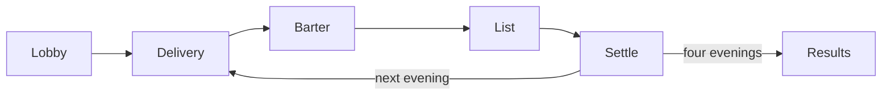

# Night Market

**4–8 players · 15–25 minutes · bilingual friends and light strategy groups.** Sell fruit, tea and lanterns at a price determined by everyone's sealed listings. Trading lets a vendor pursue a private repeat-customer contract. One shared board and one exchange per player keep negotiations short. Needs an atomic exchange ledger, sealed listings and simultaneous settlement.

## Four market evenings

Start each stall with 3 coins, no goods, one private specialty chosen uniformly from the three goods, and zero specialty sales. Each evening deal three units to each stall, independent uniform draws with a recorded seed (public aggregate deliveries, private hands). Reveal demand by drawing a daily permutation of base prices 3/4/5 across the three goods. Explain that all listings clear at the same final price for that good. No loans, sales to self or external promises enforced.

1. During 60 s barter, each seller may have one standing offer to one named counterparty, offering exactly one owned unit for exactly one different good. Reserve the offered unit. Target may accept, decline or ignore. Both seats may complete at most one exchange per evening. On acceptance verify the target's requested unit is free, expire competing offers for those seats and swap atomically. Offering seat may cancel its unaccepted offer; target may decline it. Accept, cancel, decline and phase close resolve atomically. Any terminated offer releases its reservation exactly once. Release all reservations on phase close. No coin transfers.
2. Each vendor secretly lists zero, one or two available units within 25 s. Use a final confirmation. Missing listing defaults to none. Count total units listed per good L. Unit price = max(1, base − floor(L / ceil(N/2))). Pay every listing at that good's clearing price from the bank and remove sold units. Increment specialty sales for matching units.
3. Perishability limits hoarding. After settlement keep at most 2 unsold units. If over, keep up to two specialty units first then remaining in public order fruit, tea, lantern. The exact automatic discard preview appears before confirm. Four evenings, then gain two bonus coins for at least three sold specialty units. Highest coins wins, then greatest specialty sales, then shared win. Remaining stock has zero liquidation value. Infinite bank money is bookkeeping. Goods must balance deals, sales and waste.

**Example.** Four players mean the divisor is 2. Tea base is 5 and three teas list, paying 4 each. Linh exchanged one fruit for one tea and lists two tea for 8 coins. A later acceptance of the old offer cannot move either unit. Next evening a cheap tea glut may make a fruit listing better despite her contract.

## Experience and acceptance

A market awning in indigo (#20294E) and saffron (#F9C34E), original line-drawn goods with text labels and tabular price numerals. Animate a single price flip at settlement with a text announcement. No sound required. Landing shows a worked clearing price. Tutorial lets the guest price a sale. Lobby presents the 3-good legend. The hand view displays available/reserved stock, expiry and a single trade control. Empty inventory has a deliberate Pass action. Results show market price history and a spoiler-free daily market card to share. Future rotating festivals may change demand after balancing.

Closed-group gifting, endgame hoarding and deliberate flooding are hypotheses. Barter limits constrain gifts, spoilage caps carry and all sales clear together. Simulate always-list, hoard and specialty bots and measure first-seat advantage. At 4 and 8 seats assert nonnegative stock, exact paired transfer, no coin creation outside bank settlement/bonus and no lost goods. Re-entering after a barter timeout cannot revive an expired offer. A player with no sale receives zero and retains at most two goods. Complete four evenings and compare the deterministic ledger on replay.

## Lifecycle and integration

The [room lifecycle](../contracts/room-lifecycle.md) specifies create, join, ready, initialization, resumption, host loss, minimum quorum, results, fresh rematch and cleanup, including loading, offline, empty and expired screens. Apply the game-specific exceptions above. Implement this module under `src/games/night-market/`. Its intents, projections and regression fixtures must satisfy the [module](../contracts/game-module-contract.md) and [wire contracts](../contracts/multiplayer-events.md). Publish reviewed EN/VI rules and controls for phone and desktop browsers.

## Independent review gate (IR-M05)

One completed exchange per participant; rejected/expired offers do not consume allowance. At phase close release all reservations before listings. At N=4 base=5, two units sold by one vendor with no competing listings pay 8 coins total; hoarding earns none and closing stock has no value. Always-list-two is a strong baseline; simulate greedy, specialty, hoard and coordinated flooding at 4/6/8, measure whether trade is worth the two-coin specialty bonus. Tune only after evidence. Mobile narrow offer inbox (no open chat) plus private reserved/available counts and clear settlement. Require actual repeated strategy groups before selling festival packs. R2 synthetic exclusive-action fixture precedes G4; actual trade collision tests at G4.
