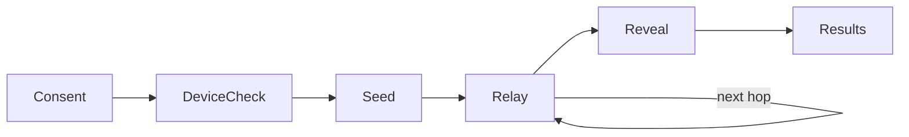

# Voice Telephone

**4–12 players · 8–18 minutes · friends on phones or desktops with supported microphones.** Pass a ridiculous phrase through short recordings, then hear where it changed. Designed for laugh-with-the-group play, with a fully playable text relay for guests who prefer it. No speech recognition, voice cloning or live conferencing.

## Rules and chain construction

Before ready, each guest chooses voice consent or text. Record only in a private room after a fresh per-match explanation of listeners, deletion and withdrawal. If any guest prefers text or a required device pair fails record/playback, offer a **whole-room text match** before start. The microphone requires a secure context and user permission. Try an agreed supported recording type (Opus/WebM then AAC/MP4 where supported). Check actual recorded MIME and cross-device decoding with an original test clip, not just API presence. Stop all tracks after preview/submit or cancellation. [MediaRecorder](https://developer.mozilla.org/en-US/docs/Web/API/MediaRecorder) · [MIME support](https://developer.mozilla.org/en-US/docs/Web/API/MediaRecorder/isTypeSupported_static)

Shuffle seats and pick distinct original prompts, e.g. “The paper moon missed the last ferry.” Create one chain per seat, so all players act simultaneously. Each chain has K = min(4,N) hops, by seats (start + hop) mod N. At hop 1 read only that chain's seed, then record up to 8 seconds (or type <=120 characters in text mode). At later hops play only the previous accepted contribution and reproduce it from memory. Give 45 s per hop including upload, a user-initiated preview and one replacement before commit. Sealed submissions are immutable. Any number of local playback attempts within the phase is permitted for accessibility. No speed points. Timed-out hop becomes a visible silent/text gap. Next player uses the closest earlier permitted non-gap recording or the seed if none. Move on when all seats commit/pass or the deadline expires.

At reveal, walk one chain at a time with explicit play buttons and textual turn order. The seed and surviving hops become accessible only to authorized consenting participants in that match. Each participant may nominate one chain for a “best detour” award, except the chain they started. Anonymous vote, most votes wins the optional chain award, ties shared. No votes gives an unranked gallery. Everyone completes the game if at least one chain contains two surviving contributions. Otherwise show “incomplete relay” and offer a text rematch. A new match clears all chains, rechecks consent and shuffles order. Future sound imitation uses original non-personal sound cues. Captions can be supplied voluntarily without transcribing other players.

**Example.** With 5 players A starts chain 1, B copies A, C passes, D hears B as the nearest earlier hop. Four other chains advance in parallel. If B withdraws before reveal, their clip is revoked and hidden everywhere. The historical gap remains. Subsequent players still own their own contributions. Stop further media collection if consent is withdrawn, allow the player to leave and continue only through the published gap/quorum rules.

## Storage, safety and experience

Use the [media grant and deletion policy](../planning/SECURITY.md). Pilot 256 KiB per clip hard maximum, <=48 accepted clips per 12-seat match. Reserve quota before issuing upload, verify container and duration server-side, reject mismatches. Transient retries reuse the same hop receipt. Test decoder/parser in an isolated, resource-bounded job. Streaming/recording failures never overwrite a prior acknowledged hop. If storage or validation is unhealthy disable new voice matches, offer text, and do not silently switch consent mid-game.

Use deep violet (#302344), pale peach (#FFE4C7) and a numbered tape timeline. Explicit record/stop, visible elapsed seconds, optional haptic cue and undo-before-commit. Never autoplay, show an empty microphone state with retry/text alternatives and headphone guidance. Share an original prompt or a fresh invitation only. No audio export in the MVP. Test consent decline, iOS Safari and Android Chrome in both directions, background/lock interruptions, size limit, deletion after withdrawal/expiry and retry after upload/ack loss. Assert no cross-chain read before reveal, all K hops terminate with AFKs, text mode supports the full award/gallery and rematch resets access. Pilot replayability and discomfort in separate anonymous feedback.

## Lifecycle and integration

The [room lifecycle](../contracts/room-lifecycle.md) specifies create, join, ready, initialization, resumption, host loss, minimum quorum, results, fresh rematch and cleanup, including loading, offline, empty and expired screens. Apply the game-specific exceptions above. Implement this module under `src/games/voice-telephone/`. Its intents, projections and regression fixtures must satisfy the [module](../contracts/game-module-contract.md) and [wire contracts](../contracts/multiplayer-events.md). Publish reviewed EN/VI rules and controls for phone and desktop browsers.
