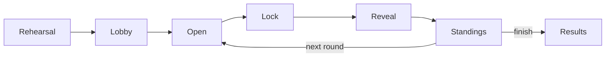

# Wedding Arena

**20–300 guests is a target envelope. The initial on-site pilot admits 20–40 guests with a rehearsed MC, one co-host, and a read-only projector.** Five to eight short rounds over 10–20 minutes. A guest can answer in Vietnamese while a tablemate reads English. Sell planners reliability, rehearsal and fast recovery. Needs short bursts of writes, a read-only display grant, preloaded run-of-show and venue-tested operator controls.

## Rehearsal and live rules

MC configures 5–8 rounds and a table count, appoints a co-host using a separate private grant, previews both languages and rehearses with a disposable score ledger. Each quiz has 2–4 answer choices, one private correct ID and an optional host note. Polls have no correct choice and award zero points. Launch requires at least one of each type, valid assets/translations, a confirmed co-host or disclosed single-operator rehearsal fallback, and a host confirmation. Supply original general celebration prompts. Couples can privately approve text about themselves. Skip sensitive details. Photos, sponsor placements and payment checkout are later work.

Guests use QR, short code or typed URL and pick their table. Assign an anonymous seat. Lock table membership after that seat's first scored round. At pilot enforce 20–40 enrolled guests at opening, independent of whether every guest marked ready. A product cap rejects overflow into a wait screen. Once opened, freeze each eligible table roster at round start. A guest arriving later first participates next round. MC opens a 30 s question after the projector displays it. Player taps one option and confirms a single final answer. Deadline or MC lock closes it. Closed rounds cannot reopen. Reveal correct answer and ordinal choice counts only after lock. A poll shows aggregate counts. Withhold breakdowns for very small groups if they would identify a guest. Never display individual answers.

For each scored quiz round use floor(100 × correct eligible seats / roster size at open). Empty table earns 0 and is marked inactive. Nonanswers earn zero. Total table points sum across scored rounds. Tied leaders share the place. A missed question does not eliminate a table. MC may void a disrupted round for *all* tables before declaring results, with an auditable reason and reversal of any points exactly once. If no valid scored rounds remain, close as an unranked celebration. For example, 6/8 gives 75 while 8/12 gives 66. A later void removes both. A rematch/rehearsal uses a new ledger.

## Venue exceptions and interface

The guest cap is distinct from the core room quorum. A guest disconnect never pauses the entire event. Reconnect the same seat. Resync open/locked state. MC loss delegates only to the pre-granted co-host after 30 s. Otherwise freeze further advances. The current round locks at deadline, projector holds a neutral intermission, and the MC can reclaim via private host recovery. Never promote a random guest to event operator. Allow manual stop with results from finished rounds. A network-wide outage pauses the show, provides a printable/offline MC run sheet, then lets the returning operator void the affected round consistently. Rehearse admission lock and use unique table tickets or operator correction before score lock if seat farming appears in the pilot.

Landing asks planners to preview a complete sample run, lobby tests contrast/distance, guest phone shows only choices and submitted status. Projector shows large ivory (#FFF7EB) on deep teal (#123F40), simple sans labels, table shapes plus names. No mandatory sound, rapid flashes or speed scoring. Provide text join info beside QR. Co-host screen has explicit rehearse/live labels, lock/void confirmations and aggregate counts. Share a host-approved standings image without guest identities.

**Scale and business gate.** Run staged 40/100/300 socket drills with skewed table sizes, simultaneous answers, venue Wi-Fi, full display and two host devices, plus a restart/recovery rehearsal. Enforce highest passed admission cap. Aggregate display fan-out at 2 Hz. Private ack for each guest. Verify denominator freeze, staleness after void, read-only projector, host handoff, mixed-locale choice IDs and one score per round. Offer a staffed paid pilot only after successful on-site rehearsal and a support/refund owner. Evaluate a separate event product if booked revenue funds event-window support.

## Lifecycle and integration

The [room lifecycle](../contracts/room-lifecycle.md) specifies create, join, ready, initialization, resumption, host loss, minimum quorum, results, fresh rematch and cleanup, including loading, offline, empty and expired screens. Apply the game-specific exceptions above. Implement this module under `src/games/wedding-arena/`. Its intents, projections and regression fixtures must satisfy the [module](../contracts/game-module-contract.md) and [wire contracts](../contracts/multiplayer-events.md). Publish reviewed EN/VI rules and controls for phone and desktop browsers.
