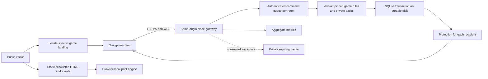

# Architecture and persistence

One repository, one public origin, one deployable live application. Serve an explicit public build directory, including the unchanged printable assets, from a Node 24 LTS process alongside same-origin HTTP and WebSocket endpoints. Keep an independently serveable static artifact for Pages compatibility and recovery. Take the final host decision only after proving control of the canonical route. All paths below are proposed.

## Layout and dependency direction

| Proposed area | Ownership and permitted imports |
|---|---|
| `src/contracts/` | Wire schemas, DTOs, IDs and public registry shape. Portable TS. No DOM, SQLite, game implementations, secrets or Node APIs. |
| `src/games/<slug>/{server,client,content,tests}/` | Each server engine imports contracts and pure helpers. Each client imports only public contracts, own client resources and shared UI. Each game exports its public descriptor and separately its server registration. |
| `src/platform/server/` | HTTP, WebSocket, membership, room serialisation, timers, SQL, feature flags, media grants and operations. Calls module methods through the server registry. Module has no direct socket or database handle. |
| `src/platform/client/` | Socket adapter, room shell, join, status, privacy, keyboard/focus behavior, network retry and localized messages. Load game view by slug through an explicit allowlist. |
| `content/public/{en,vi}/`, `scripts/build-public.*` | Renders meaningful HTML, CSS and static social images. Generated client manifest contains only public assets. Import private content exclusively on server. |
| `migrations/`, `tests/live/`, `ops/` | Single migration owner, cross-module contracts/E2E and restore/load scripts. Original JS and static files retain their entry points. |

Use TS strict, noUncheckedIndexedAccess, exactOptionalPropertyTypes and exhaustive discriminated unions for new code. Compile to ESM with tsc. Browser modules use resolvable relative imports or a small entry bundler if build measurement justifies it. Add a mature WebSocket library (candidate `ws`) for Node upgrade/frame handling and one runtime schema validator (candidate Zod, server-side, generate small public types or compile narrow client validators). Compare pinned runtime/size/licenses before locking. Evaluate Node 24's SQLite API stability and synchronous transaction latency in the target runtime. If unsuitable, pin a maintained SQLite binding behind the storage adapter. Native HTTP plus a maintained static file handler with an allowlisted root is sufficient for the pilot. Keep deployment tools and all server code outside the public output. The current Pages mirror publishes the tracked root. Before server bundles are introduced, switch that mirror to an allowlisted static artifact and verify the old project-prefix links. Anything committed to this public Git repository is still public regardless of deployment filters.

## Data model and atomicity

| Record / key | Fields and invariants | Lifetime |
|---|---|---|
| rooms / random id | unique normalized live code, gameId, engineVersion, contentVersion, protocolMajor, status, phaseId, rev, hostSeatId, deadlineAt, expiresAt, authoritative JSON, private seed and PRNG cursor. Unique code collision retries before display. | Lobby idle 30 min, small matches at most 4 h, results 15 min. Active event leases up to 8 h. |
| sessions / digest | Hash of high-entropy cookie, expiry, revocation state. membership PK (roomId, seatId), unique (roomId, sessionId), alias, seat order, ready, grants. Presentation principal has its own read-only grant. | Session idle 24 h, room membership cascades. Prefer ephemeral aliases. |
| accepted_commands / room, match, seat, commandId | Body digest, phase, revision, **private acknowledgement receipt**. Unique key. Duplicate with a different body is a conflict. Never re-run or re-charge. | Retain through match results. Rematches allocate a new match ID. |
| due_jobs / room, match, phase, kind | DueAt and expected phase make timer effects idempotent. Store in same transaction as deadline. Indexed by dueAt. | Consume atomically. Boot scans before accepting new actions. |
| media_grants / opaque handle | Owner, room, match, hop, allowed readers, verified MIME/length, expiry, tombstone and cleanup status. No public URLs. | [Media-specific retention](SECURITY.md). |
| aggregate counters / date, game, locale, event, version | Bounded dimensions, totals, latency buckets. Future purchases have separate order state, deduplicated provider event ID and entitlement grant. | [Measurement policy](ANALYTICS.md). Outsource card handling if purchases approved. |

SQLite WAL, foreign keys enabled, short transactions and a bounded room queue. On command, load authoritative revision, validate, compute new state, persist state/receipt/job and any reliable analytics/outbox change together, then commit before broadcasting. A compare-and-set on revision rejects a stale writer even if queue ownership is broken. Only one process may open the write volume in the pilot. Use bounded transactions and observe busy time and WAL growth. Batch public tally notifications. Persist accepted answers and never broadcast private ballots. An event journal is optional for development using synthetic data. The pilot needs a durable snapshot and receipt, not permanent logs of speech, clues or votes.

Persist a start seed and engine/content versions so retries and old rooms remain deterministic after deployment. Independent rooms can progress concurrently except for the short SQLite write lock. Slow clients get one latest bounded snapshot and a resync signal. Repeated lag disconnects that socket without slowing the room. Throttle projector aggregates to at most 2 Hz. Clients render countdowns locally from server deadlines. Re-evaluate a due deadline immediately after restart and on any late command.

## Shared UI and extraction

Build join/create, ready roster, focus-trapped confirmation where appropriate, time remaining, retry status and results in the first slice. Add a generic choice list after Friend Court and Corporate Chaos independently demonstrate the same semantics. Trading escrow, mystery evidence, audio chains and projector control stay owned by their game. Host privileges coordinate starts and moderation. Each client receives only its authorized view. Room discovery is by explicit invitation or human-entered code. There is no public directory of active rooms.

Single origin simplifies cookies and low-friction joins. A new product can later take its module, public manifest entry, content rights and the same storage/transport interfaces. Keep configuration by game, segregated measurements and versioned URLs. Extract a deployment only when the buyer, on-call window, economics or load justifies maintaining it. [Game contract](../contracts/game-module-contract.md) · [Transport](../contracts/multiplayer-events.md) · [Lifecycle](../contracts/room-lifecycle.md) · [Deployment and cost](DEPLOYMENT.md)
