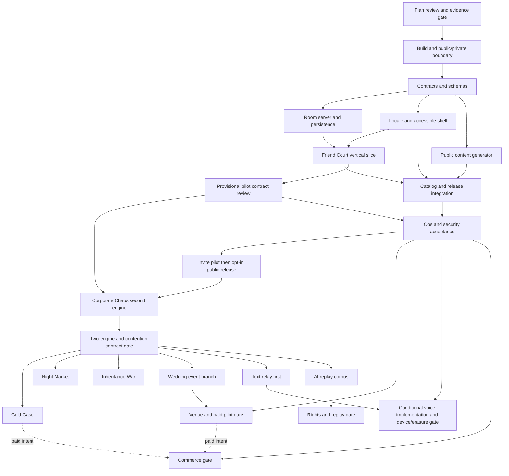

# Dependencies, release order and production gates

All delivery estimates are **focused solo engineer-weeks**, with a bilingual editor, recruited hosts and access to real devices when needed. They exclude waiting for pilots, payment review and domain approvals. Ship one real game before expanding the shared layer. Review capacity and estimates after each observed release. An autonomous agent completing code cannot substitute for live event rehearsal or editorial approval.

Arrows are minimum dependencies. Every title entering public release also needs I1, O1 and the readiness checklist. Foundation and content discovery can overlap after interfaces stabilize. R1 stabilizes only the pilot interface. R2 requires two executable engines with real-socket, compatibility and contested-action tests; shared helpers follow observed duplication. L1 means accepted private-pilot evidence, not automatic public rollout. Roadmap and backlog IDs match. [task scopes and commands](TASK_BACKLOG.md) are normative for implementation.

| Milestone, size | Objective / expected modules | Depends on / scope limits | Acceptance, regression and rollback |
|---|---|---|---|
| P0, ½–1 wk | Owner reviews plan, brand/domain, funding ceiling, current config and Tamil baseline. Recruit independent VI/EN hosts, compare Friend Court and Corporate Chaos via counterbalanced paper tests · record decisions in PROGRESS/DECISIONS. | Planning approval precedes **any application implementation**. Purchases and deployments require separate authorization. | Demonstrate unaided candidate sessions, record selection, source/cost and safe hosting/recovery evidence and owner-approved scope · record hard blockers. Run existing npm test and targeted E2E. If branding/hosting unresolved, continue paper validation only for affected decisions. |
| F1–F3, 2–4 wks | Single repo, strict live build, schemas, SQL schema v1 and room actor at src/contracts, src/platform/server, migrations and ops. | P0. Preserve all print routes, no accounts, live billing, broker or second writer. Own package/lock and DB migrations centrally. | Type/build/contract/room/restore tests pass · old entry points work below a path prefix. Verify that private files are excluded and published assets remain available. Disable live router and restore known static artifact. |
| P1/A1/I1, 1–2 wks (overlap) | Accessible mobile room shell, EN/VI public rules templates, catalog entry, analytics allowlist and feature flags. | F2 for shell/manifest · join to a real backend before publishing. Only active games have public discovery entries. | Static crawl, locale parity, contrast, disabled-analytics and old query-link tests pass. Check for duplicate canonicals and legacy translation rewriting room text. Restore previous navigation/sitemap and keep room creation closed. |
| S1/R1, 2–3 wks | Friend Court through invitation, hidden ballot, transition, recovery, results, share and rematch. One new GDD-driven module, 16 dockets + reserve/language. | F3 + P1 · A1/I1 before public listing. Hold custom disputes, open chat and commerce. | Four independent browsers complete and rematch after host loss · no ballot leak. Observe VI and EN host including pass/typed path. Record provisional pilot interface fixtures at R1, revise before second engine; no general contract freeze. Roll back per-game flag and drain. |
| O1/L1, 1–2 wks then ongoing | Staging, deploy/restore, cost baseline, security/privacy, accessibility, support and limited release. | First real slice, public integration and completed baseline repair. No open marketing or ads until gates pass. | Run all gates below · release to whitelisted hosts, then small public cohort, then general discovery if evidence supports. If budgets or error targets fail, stop creation, recover sessions, retain print access. |
| G2, 2–4 wks | Corporate Chaos second-engine/flagship candidate · module, private mandates, four-quarter simulator, facilitator guide. | Accepted L1 + R1. Exclude performance evaluation and paid role powers. | GDD fixtures and seeded free-rider test, readable 4/10-seat audit trail · risk dominant self-promotion. Gate behind flag and retire flawed deck version at room expiry. |
| R2, ½–1 wk | General contract decision after two executable engines plus exclusive-resource contention fixture. | G2 + accepted L1; no new abstraction without observed need. | Both engines pass real-socket, restart, hidden projection and compatibility tests; contested action commits once. Record version/hash and unresolved differences. |
| G3, 2–4 engineering wks + 2–5 editorial wks/case | Cold Case engine, pack schema/linter, original free case and blind test. | R2 · authoring/rights research may begin after P0. No automatic case generator. | Two structurally different test packs load, native reviewers can solve without guessing, no private solution in public output · risk spoilers. Unlist compromised pack and pin active rooms to reviewed content. |
| G4, 2–3 wks | Night Market simultaneous exchange/list/settle and price guide. | R2. Three goods, one barter per player/evening. | Conservation and concurrent accept tests plus 4/8-seat complete markets. Risk duplicated trades. Stop new rooms and recover from last committed snapshot. |
| G5, 2–3 wks | Inheritance War nominations, votes and custody ledger. | R2. One estate, no user-written wills. | Tie/timeout/cap fixtures, no dominant permanent bloc in moderated pilots. Risk kingmaking. Pause new estate version, keep active match reader. |
| G6/E1, 3–6 wks + venue scheduling | Wedding rehearsal, operator grants, projector, table score, paper fallback and paid-event pilot. | R2, O1 plus named operator and venue. Exclude photo uploads and unattended initial sales. | Burst at staged cap, co-host failover, complete onsite rehearsal and buyer willing to book. Risk live outage. Fall back to MC run sheet, void affected round, honor booking agreement. |
| G7/V1, 3–5 wks combined + device sessions | G7 private text relay; V1 conditional consent, audio grants/deletion and device exchange. | G7 requires R2; V1 requires G7 evidence + O1 + storage/retention review. Exclude public galleries, export and transcription. | G7: complete text relay and repeat-preference evidence. V1 only: cross-device playback, withdrawal and janitor/restart deletion tests. Risk inaccessible or undeleted clip. Revoke grants, stop new audio, purge and offer a new text match. |
| G8/C1, 2–4 wks + corpus review | AI Battle replay matrices, rubric evaluator, anonymously grouped votes. | R2 and reviewed provenance. Zero live inference. | Full real corpus at launch, 2/8-seat replay/zero-bill tests, language fairness · risk stale model assumptions. Disable bad pack and keep verified packs. |
| B1, 1–3 wks when justified | Entitlement receipt, reconciliation, refunds, booking support and unit economics tracking. | Evidence of paid intent for G3 or G6, reviewed terms. Keep recurring subscriptions and live AI disabled. | Provider sandbox retry/refund and restore tests, positive expected contribution under measured support · risk duplicate charges or lost access. Disable checkout, honor existing receipts manually. |

## Prioritization under a single maintainer

**Friend Court is the provisional first engineering candidate**, not an assured demand winner. It exercises ordinary rooms and private ballots without specialist infrastructure, but direct competition and low agency at large N require P0 comparison. If Corporate wins P0, formally revise S1/G2 and dependencies before F1. Corporate Chaos tests whether this base can handle hidden goals and resource commitments. Start Cold Case editorial work during the slice. Paper-test Cold Case and paid intent before Corporate if appropriate, but do not implement G3 before R2. Wedding discovery and rehearsal-sales interviews start early, even though public admission waits for operational proof. After R2 rank candidates by evidence, not predetermined release dates: Cold Case if blind solves/paid intent justify writing; Night Market if strategy groups prefer it; Inheritance only if distinct; Wedding staffed venue pilot; Voice text-first; AI replay only after rights/editorial/replay evidence. No obligation to ship all eight. A booked, staffed Wedding pilot can proceed privately ahead of Night Market once its gates pass. Ordering expresses opportunity cost and operational dependencies. No simultaneous eight-game launch.

| Candidate | Distinctiveness / replay | Acquisition / sharing | Business / delivery risk |
|---|---|---|---|
| Friend Court | High first-session accessibility · fresh dockets needed | Short rule page and fictional verdicts | Fast/low infra · humor safety and quality |
| Corporate | Strategic repeated play · role tuning | Office facilitator search/debrief | Team licenses plausible · balancing medium–high |
| Cold Case | Strong first solve · limited repeat of same case | Local editorial search and referrals | Direct paid packs · costly content throughput |
| Night Market | Variable clearing prices, repeated negotiation | Strategy guide, public price histories | Moderate differentiation in crowded theme · atomic trades |
| Inheritance | Highly social but overlap with Corporate | Niche rules search and estate summaries | Ship after a playtest shows distinctive choices |
| Wedding | Recurring organizer, often one-off guests | MC guides, planner referrals | Highest service-sale potential and critical live window |
| Voice | Surprise reveal, variable consent | Invitations · audio stays in room | High device/privacy cost · weak paid boundary |
| AI | Rubric replay · finite matrices | Searchable practice briefs | Low live cost in replay mode, costly editorial renewal · live AI carries high financial risk |

## Definition of public-ready

- [ ] Owner approved scope, canonical origin, budget and support coverage. CI and staging identify exact build, pack and schema versions.
- [ ] Old print/answer keys, locale/theme, deep links and static fallback pass regression, including the documented Tamil check.
- [ ] All GDD actions, win/defeat/tie, abandonment, protected projection, expiry and fresh rematch pass against real server and storage.
- [ ] Mobile, keyboard, screen reader, reduced motion and both language editors have signed off. Loading, declined permission and reconnect work on physical devices.
- [ ] Public HTML, canonicals, reciprocal alternates, social images and sitemap verified. Rooms require auth and have noindex/no-store. Publish accurate Privacy, Terms and a private support route.
- [ ] No hidden content/keys in client output/logs, moderation/report owner identified, retention and restore independently verified. Current free/paid scope explicit.
- [ ] Load report names tested cap/region/tier and field latency. Alerting, caps, shutdown, undo/restore and cost reconciliation exercised.
- [ ] Pilot with independent hosts completed. Owner recorded go, revise, pause or retire with evidence and date. Attach receipts in [progress](PROGRESS.md).

## P0 and L1 decision receipts (IR-H05, IR-H07)

P0 is the only immediately approvable work: approve corrected plan, verify hosting/domain/retention/budget, recruit hosts, paper-test both candidates. Proposed discovery thresholds (owner may adjust before experiment): six independent groups per candidate spanning both languages and at least two sizes; counterbalance order where possible. At least five per candidate finish unaided; record time to first action, idle/pass fraction, rule errors, preference and voluntary repeat commitment. Prefer Friend Court if it clears the bar and is competitive; if Corporate materially wins revise S1/G2; if neither clears revise and retest. No app implementation, purchasing or deployment during P0.

After approved P0, F1 is the exact next engineering milestone: isolated static/live public allowlist, preserve old URLs and independent print fallback, smallest evidenced Tamil repair, legacy all-locale/RTL/print regressions, runtime/browser pin, route/artifact smoke and rollback. Then F2/F3.

After S1/R1/I1/O1, L1 invite-only: propose 20 independent start-cohort groups in EN/VI and size bands; at least 15 finish unaided and at least 8 completed groups voluntarily rematch or commit a second hosted session. Zero unresolved security/score/recovery failures. Report denominator, Wilson intervals, selection/consent bias, support time and measured cost. This is directional usability evidence, not product-market fit. Gate G2 on accepted L1; R2 then controls wider implementation. Public launch still requires checklist and owner acceptance. One game branch active before R2, at most two afterward with human integrator.
